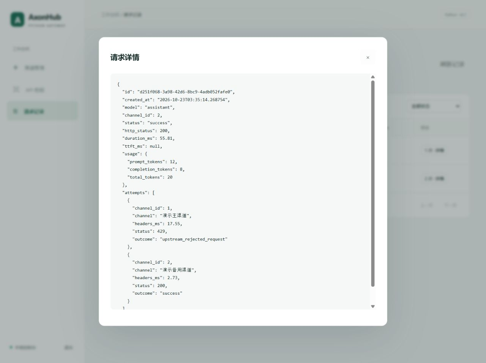

# AxonHub Python

基于 [AxonHub](https://github.com/looplj/axonhub) 的使用场景和设计，重新实现的精简 Python AI 网关。
当前聚焦 OpenAI Chat Completions 兼容接口、流式响应、渠道调度和请求观测。
原项目的多团队权限、云平台接入和多协议转换没有搬入此版本。
迁移前的 Go 版本保留在 [go-baseline 标签](https://github.com/WDSDSASDZX/axonhub/tree/go-baseline)。

## 启动

需要 Python 3.12+ 和 [uv](https://docs.astral.sh/uv/)：

```bash
uv sync --locked
uv run axonhub init
uv run axonhub
```

打开 http://localhost:8091 。使用本地 `.env` 中的 `AXON_ADMIN_TOKEN` 登录。
初始化只创建本地配置，不打印凭证；文件权限为 600，重复运行不会覆盖已有凭证。
`AXON_ENCRYPTION_KEY` 用于解密供应商密钥，需与数据库一起备份，不能随意更换。

默认只监听回环地址。可用 `uv run axonhub --port 8093` 修改端口。
如果已有其他用途的 `.env`，可使用 `uv run axonhub init --env-file .env.python`，
再通过 `uv run axonhub --env-file .env.python` 启动，避免覆盖原配置。

## 使用流程

1. 在“渠道管理”添加供应商。基础地址包含其路径前缀，例如 `https://provider.example/v1`。
2. 设置对外模型名与供应商模型 ID 的映射。两个渠道使用相同对外模型名，即可参与轮询和故障切换。
3. 创建客户端 API Key。完整 Key 仅在创建时返回一次，数据库只保存摘要。
4. 客户端使用本地地址 `http://localhost:8091/v1`、新建的 Key 和对外模型名。
5. 在“请求记录”查看状态、总耗时、首段输出、用量和各次上游尝试。



管理凭证与客户端 Key 分开，供应商密钥加密保存。请求日志不保存提示词、回答正文或认证头。
页面中的服务器返回值通过文本节点渲染。

## 调度与统计口径

- 使用平滑加权轮询。每个客户端请求最多尝试 3 个不同渠道，可用 `AXON_MAX_ATTEMPTS` 调整为 1–5。
- 网络错误、超时和上游 5xx 可以切换渠道。401、403、429 会立即让渠道进入冷却。
- 其他失败累计达到 `AXON_FAILURE_THRESHOLD`（默认 2）后冷却，时长由 `AXON_COOLDOWN_SECONDS`（默认 30）控制。
- 开始转发流式响应后不再重试。流中断通过 SSE 错误事件和失败日志报告，不伪造完成标记。
- 请求预算是**本地派发次数上限**，失败尝试也消耗一次。采用数据库原子更新预留，防止并发超额；它不是供应商账户真实剩余额度。
- 总耗时使用单调时钟，记录结束后冻结。TTFT 仅在首个非空流式内容、推理内容或工具调用到达时记录。
- usage 作为上游快照保存，重复事件不累加。缺失用量为未知，不显示成零；非流式请求不估算 TTFT。
- 失败重试仍可能产生供应商计费，网关不承诺“失败即免费”。

## 本地演示

无需真实供应商密钥，可在另一个终端运行：

```bash
uv run python scripts/demo_upstream.py
```

演示服务默认监听 127.0.0.1:18092（可用 `--port` 修改），所有响应和 Token 数据均为模拟：

| 渠道 | 基础地址 | 行为 |
| --- | --- | --- |
| 演示主渠道 | `http://127.0.0.1:18092/fail/v1` | 返回 429 |
| 演示备用渠道 | `http://127.0.0.1:18092/v1` | 返回普通或流式响应 |

两个渠道均配置对外模型名 `assistant`，供应商模型名 `demo-chat`，密钥使用 `demo-only`。
调用后可以在请求详情中看到故障切换。演示完成后停用这两个渠道。

## 验证

```bash
uv run pytest -q
uv run ruff check .
uv run ruff format --check .
uv build
```

测试覆盖鉴权、密钥存储、模型映射、Unicode/工具调用流、断流、轮询、并发预算、
冷却恢复、重复 usage，以及真实 TCP 连接下的客户端断开与上游释放。测试不调用付费 API。

## 当前边界

- 仅支持 OpenAI Chat Completions 兼容供应商，尚未实现 Anthropic/Gemini 原生协议转换。
- 路由健康状态和轮询分数保存在进程内，当前按单进程运行；多实例共享状态需要后续设计。
- 默认使用新建 SQLite 数据库，首次启动自动创建表；尚无旧 Go 数据导入与跨版本数据库迁移。
- 未实现供应商真实额度采集、实际费用结算、团队权限和请求正文存储。
- 实际供应商的兼容性需要使用自己的配置验证，本地模拟结果不代表真实供应商性能。

容器部署：初始化本地配置后运行 `docker compose up --build -d`。
使用其他配置文件时设置 `AXON_ENV_FILE=.env.python`。容器同样只映射回环地址，
本地服务与容器默认使用同一端口，请选择一种启动方式。

设计与模块说明见 [docs/architecture.md](docs/architecture.md)。
Python 实现使用 Apache-2.0 许可，来源说明见 [NOTICE](NOTICE)；
旧 Go 子目录的许可信息保留在 `go-baseline` 标签中。
