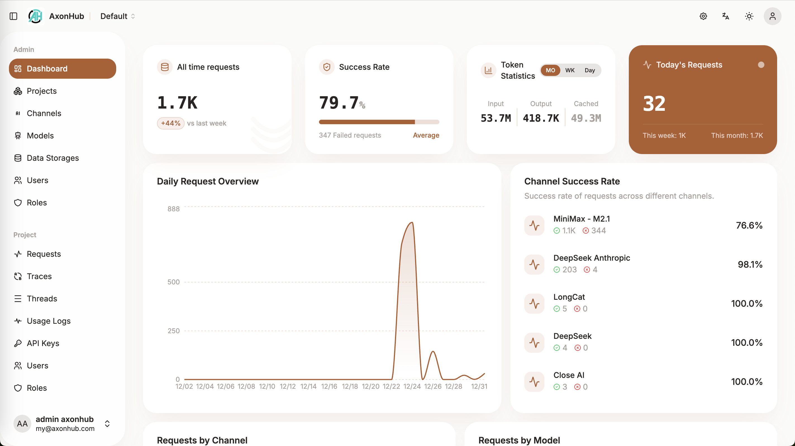
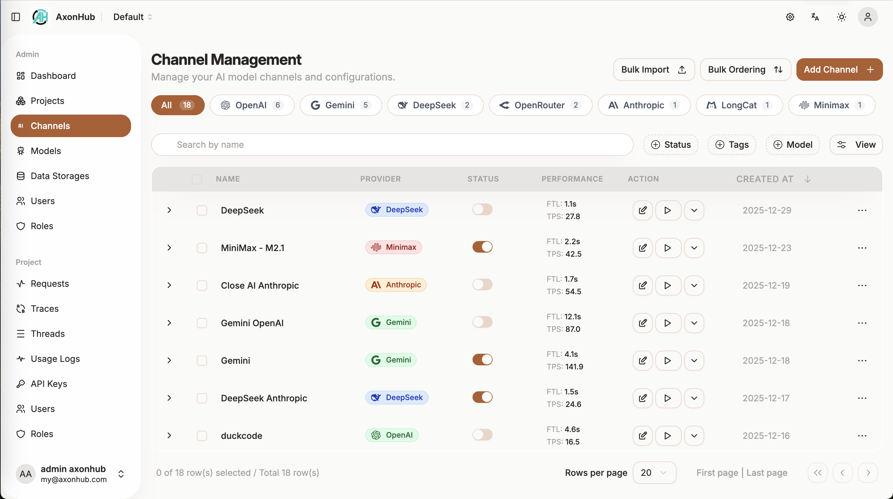
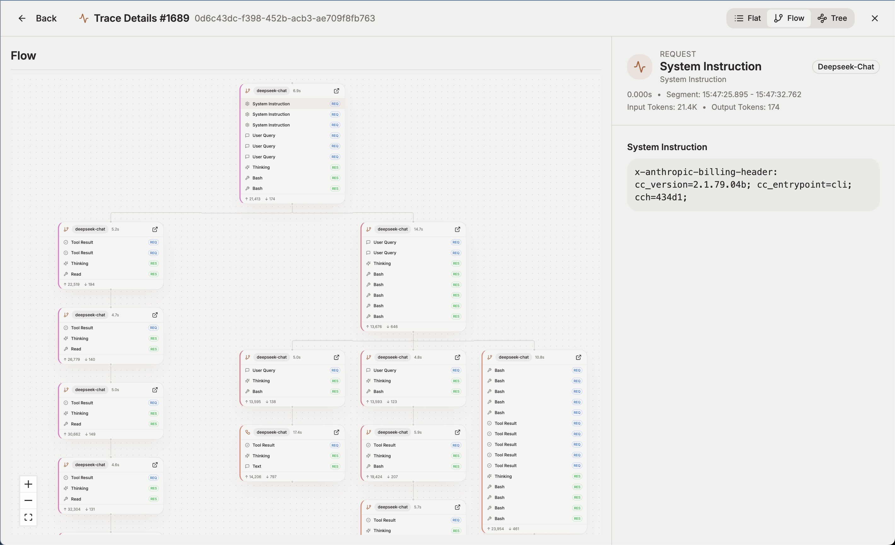

# AxonHub Personal

基于 [AxonHub](https://github.com/looplj/axonhub) 改造的个人模型网关。保留 Go 在线转发核心，精简团队管理流程，整合 DSH Jet Hub 的多账号、静默续期、额度、签到、模型开关和跨渠道聚合功能，并由 Python 后台发布直接渠道的临期额度策略。

个人版安装、运行方式、与原版的差异和当前限制见 [个人版说明](docs/personal-edition.md)。平台适配器由已安装的 Jet Hub 插件执行；本项目并未把整个插件重写成 Python。以下保留原有网关能力说明。

## 它到底干什么

- 你继续用原来的 SDK（OpenAI 的、Anthropic 的都行），一行代码不用改
- 后端随便换模型：GPT、Claude、Gemini、DeepSeek、GLM、Kimi、豆包……改配置就行
- 每个请求都有完整的 trace，出问题能看清楚是哪一环慢的、哪一环挂的
- 按渠道做负载均衡和自动故障转移，某个 key 被打爆了会自动切走
- 实时算钱：每次调用的输入/输出/缓存 token 都记账，月底看账单不再心惊肉跳

## 支持的供应商

测试过能正常跑的：OpenAI、Anthropic、智谱、月之暗面、DeepSeek、豆包、Gemini、Jina、OpenRouter、NanoGPT、ZAI。AWS Bedrock 和 GCP 上的 Claude 在慢慢补，基本能用但没完全测完。

文本、图片生成、rerank、embedding 都支持了。Realtime 对话还在 TODO 列表里躺着。

## 怎么跑起来

 quickest 的方式是 Docker：

```bash
docker compose up -d
```

或者本地直接跑（需要 Go 1.26+ 和 Node）：

```bash
# 后端
go run ./cmd/axonhub

# 前端（开发模式）
cd frontend && pnpm install && pnpm dev
```

默认端口 8090，第一次打开会有个初始化向导，建个管理员账号，然后：

1. 在 **Channels** 里加你的供应商 key，测一下连通性
2. 在 **API Keys** 里建一个给客户端用的 key
3. 把客户端的 base_url 指过来就完事了：

```python
from openai import OpenAI

client = OpenAI(
    base_url="http://localhost:8090/v1",
    api_key="你的-axonhub-key"
)

resp = client.chat.completions.create(
    model="gpt-4o",   # 实际后端可以是任何模型，配置里映射
    messages=[{"role": "user", "content": "hello"}]
)
print(resp.choices[0].message.content)
```

配置文件看 `config.example.yml`，基本都是环境变量也能覆盖，SQLite 开箱即用，要上生产再换 MySQL/PostgreSQL。

## 一些截图

| 仪表板 | 渠道管理 | 请求追踪 |
|---|---|---|
|  |  |  |

## 技术栈（给想改代码的人）

- 后端：Go + Gin + Ent + gqlgen，依赖注入用的 FX
- 前端：React 19 + TypeScript + TanStack Router/Query + Zustand + Tailwind
- `llm/` 是独立的 Go module，放所有格式转换和 pipeline 逻辑，想贡献新供应商主要看这里

更多细节在 `docs/zh/` 下面，写得还算全。

## 致谢

转换层的思路参考了 [musistudio/llms](https://github.com/musistudio/llms)，管理后台模板基于 [satnaing/shadcn-admin](https://github.com/satnaing/shadcn-admin)，在此谢过。

## License

Apache-2.0 / LGPL-3.0 双许可，具体见 [LICENSE](LICENSE)。
