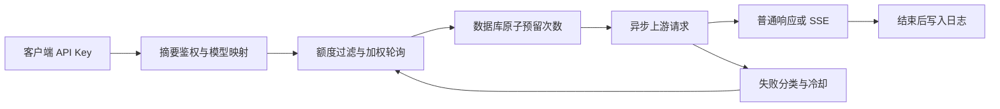

# Python 网关设计

## 范围

单管理员、OpenAI Chat Completions 兼容协议、新 SQLite 数据库、单进程运行。
HTTP 请求由 HTTPX 异步客户端转发，管理页面为无构建步骤的 HTML/CSS/JavaScript。
上游 AxonHub 提供场景与设计参考；原 Go 源码保存在 `go-baseline` 标签。

## 请求路径

失败只在向客户端提交响应之前切换，且每次最多选择配置数量内的不同渠道。
客户端断开由独立监听任务处理，取消等待中的上游读取，关闭响应并保存日志。
此行为包含真实 TCP 测试，不能只用会缓冲流的内存客户端代替。

## 模块

| 文件 | 职责 |
| --- | --- |
| `app.py` | 生命周期、连接池、静态页面与路由 |
| `admin.py` | 渠道、客户端 Key、请求列表管理 |
| `security.py` | 管理员鉴权、客户端摘要查询、供应商凭证加密 |
| `gateway.py` | 请求映射、失败分类、上游响应和 SSE 处理 |
| `routing.py` | 平滑加权轮询、冷却状态、数据库原子额度预留 |
| `streaming.py` | 客户端断开监听与流资源清理 |
| `telemetry.py` | 单调计时、首段输出、用量快照和最终日志 |
| `db.py` | 数据模型、独立数据库会话与建表 |

## 数据与并发

渠道密钥使用 Fernet 加密；客户端 Key 具有足够随机性，数据库仅保存 SHA-256 摘要。
管理凭证和加密密钥来自环境配置，不写入代码和日志。数据库不保存对话正文。

额度预留通过一条带条件的 UPDATE 完成，在多请求同时读取旧快照时仍不会突破上限。
每次上游尝试消耗一次，失败不返还，避免把未知的上游计费状态当成未使用。
轮询分数与冷却状态留在进程内，因此当前只支持单工作进程的调度语义。

首段输出不以响应头、角色事件、用量事件作为起点。总耗时在结束时冻结，
usage 事件是快照，不能累加。流式 HTTP 200 后仍可能失败，日志会同时保留 HTTP 状态和最终结果。

## 验证与后续工作

当前测试涵盖成功路径、故障切换、冷却到期、并发预算、重复事件及真实连接取消。
本地演示供应商响应和 Token 都是模拟数据，尚未对真实供应商宣称兼容性或性能结果。

后续可独立推进：带版本的数据库迁移、供应商真实额度采集、原生 Anthropic 适配、
多进程共享调度状态、日志保留策略。每项需带行为测试和可复现的运行验证。
